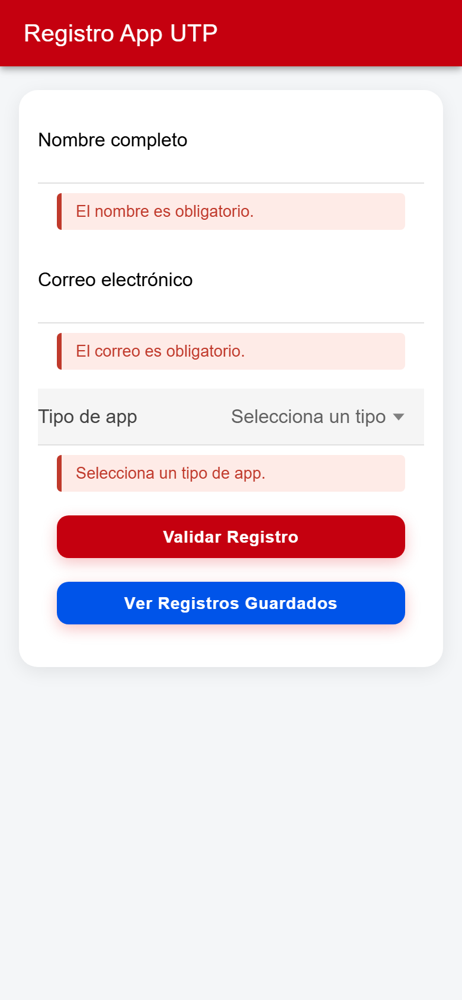

# Registro App UTP · Semana 14

Una app móvil sencilla para **registrar usuarios y consultarlos** desde una API. La hice con **Ionic + Angular** para la semana 14 del curso de **Diseño y Desarrollo Web Integrado (DWI)**, y se puede empaquetar como APK de Android.

Es la continuación de la app de la [semana 11](https://github.com/Nakusuo/Semana-11-appMovil): ahí la validación era solo local; aquí los datos ya viajan a un servidor y se pueden volver a leer.

| Validaciones | Detalle del registro | Lista de registros |
|---|---|---|
|  |  |  |

## Qué aprendí haciéndola

- **Formularios reactivos** con validaciones (nombre de al menos 3 letras, correo válido, tipo obligatorio) y mensajes debajo de cada campo.
- **Consumir una API** con `HttpClient`: un `POST` para guardar el registro y un `GET` para listarlos, con estados de carga y de error.
- **Navegar entre páginas** pasando datos: al guardar, la app abre el detalle con lo que se registró.
- **Componentes que se hablan**: el resumen recibe el registro con `@Input` y el selector de tipo avisa el cambio con `@Output`.
- **Deslizar para refrescar** la lista de registros.

## Sobre la API

La API era un mock en [Beeceptor](https://beeceptor.com) (`https://utp-14.free.beeceptor.com/registros`). Ese endpoint gratuito ya no responde, así que las capturas se tomaron simulando en el navegador la misma respuesta que daba. Si quieres probarla con un backend real, cambia `apiBaseUrl` en `app-utp/src/environments/environment.ts` por tu propio endpoint de Beeceptor u otra API con `POST` y `GET` en `/registros`.

## Con qué está hecha

Ionic 8, Angular 20, TypeScript y Capacitor para Android.

## Cómo correrla

```bash
cd app-utp
npm install
npm start          # http://localhost:4200
```

Para generar el APK de Android:

```bash
./generar-apk.sh   # en Windows: generar-apk.bat
```

O a mano: `npm run build`, `npx cap sync` y `cd android && ./gradlew assembleDebug`. El APK queda en `android/app/build/outputs/apk/debug/app-debug.apk`.
